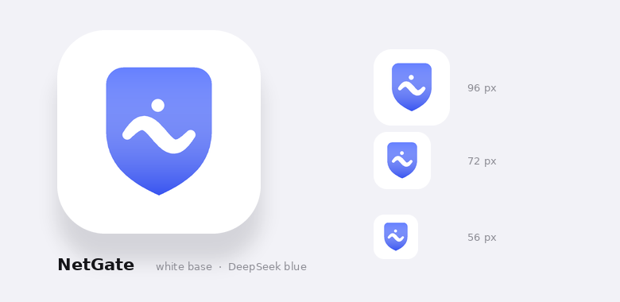

# NetGate

**加速器没连上、或者已经悄悄掉线的时候，把受保护的应用挡在门外。**

一个只有 110 KB 的 Android 本地工具。不代理流量、不上传数据、不需要服务器，
只在本地回答一个问题：*现在这条隧道，真的通吗？*

<p align="center"></p>

---

## 它解决什么问题

用加速器玩游戏时，最难受的不是断线，而是**断得不明不白**：

- 游戏已经连不上，界面还停在原地转圈；
- 或者你压根忘了开加速器，一局排位已经开始；
- 系统能连上 Wi-Fi，但隧道是死的 —— 所有"网络正常"的判断都会骗你。

NetGate 的做法很直接：**打开受保护的应用之前，先真连一次**。连不上就不让进，
并告诉你最近一次校验失败在哪一步。

## 为什么不能只看"有没有 VPN"

大部分加速器是 fake-ip + tun 本地代答：你发出 SYN，tun 自己回一个 SYN-ACK，
包根本没离开手机。这时哪怕节点早已超时，TCP 连接也会在 1～2 ms 内"成功"。

所以判定分两层：

| 层 | 看什么 | 结论 |
|---|---|---|
| 通道 | 默认网络是否带 `TRANSPORT_VPN`，系统里是否有 tun/ppp 网卡 | 有没有加速器 |
| 可用 | 把连接**绑定到 VPN 网络**，做 TCP → TLS（带 SNI）→ HTTP 请求，读到响应首行 | 隧道是否真的在转发 |

TLS 握手需要远端私钥参与，本地伪造不了 —— 这是唯一不会骗人的信号。
如果加速器是分应用代理、本应用没有资格走它的隧道，会返回「无法验证」并放行，而不是误杀。

## 三个核心机制

**1. 前台监听**
无障碍服务订阅 `TYPE_WINDOW_STATE_CHANGED`，结合窗口列表判断当前前台是谁；
命中受保护应用时立刻触发校验，不需要轮询、不读屏幕内容。

**2. 实时巡检**
受保护应用在前台时按灵敏度持续探测（默认 5 秒一次，带 ±2 秒随机偏移）。
有 VPN 时后台完全不动，只在通道真的消失后才开始清扫 —— 而且要先等 6 秒，
避免加速器切节点时把后台挂着的游戏一起误杀。

**3. 结束进程**
通过 Shizuku 以 `shell`(uid 2000) 身份执行，按可靠性逐级降级：

```
am force-stop → am kill → kill -9（枚举 /proc 逐个 PID）
   → pm suspend（挂起） → pm disable-user（禁用，恢复网络后 pm enable 还原）
```

最后两级会改动系统的应用启用状态，因此默认开启、可在主界面关掉（「强停无效时挂起应用」）。
**桌面、输入法、拨号、短信、设置、SystemUI、Shizuku 永远不会进入这两级**，
连 force-stop 都跳过 —— 这些包一旦被停用，用户会失去自救入口。

是否杀干净不看退出码，而是用 `ps -A` 和 `/proc/<pid>/cmdline` **两路独立计数取最大值**，
0.7 秒、2.5 秒各复查一次；只要还剩进程就继续降级。

## 节点锁（按应用）

保护分两层：

| 层级 | 怎么进入 | 放行条件 |
|---|---|---|
| 普通保护 | 「受保护应用」里勾选 | 有 VPN 通道 + 握手通过 |
| 节点约束 | 「节点锁」里再勾一次 | 上面两条 + 出口国家 = 锁定值 |

节点锁不影响整个名单，只影响你单独点名的几个应用。适合
「pubgm 必须走日本，其他游戏哪个节点都行」这种场景。

### 为什么锁的是国家

加速器的「节点」是它自己的私有概念，Android 层读不到——它不会把「当前是日本 01」
交给系统，也没有任何公开接口能拿到。能读的只有**出口指纹**：出口 IP、国家码、
Cloudflare 边缘机房（读取 `cloudflare.com/cdn-cgi/trace`）。

- 不锁 IP：运营商会给落地机每天重新分配出口 IP，锁 IP 第二天就失效；
- 不锁机房：同一城市的多个节点在出口上没有区别，锁了也分不开；
- 锁国家：唯一稳定、又能区分「日本 / 美国 / 香港」的粒度。

实测同一台落地机的两条线路（「日本 01」「日本 02」）出口 IP、国家码、机房三项
完全一致，只有路由不同——这正是锁国家这个粒度的由来。

### 用法

1. 连上要用的节点（也可以不连，直接手动选）；
2. 主界面「节点锁」→ 点卡片 → 选国家（日本 / 美国 / 香港…）→「锁定」。
   读到出口时会自动预选当前国家；读不到就手动点一个，不依赖网络；
3. 同一页「限定节点的应用」→ 勾选需要约束的应用；
4. 其余受保护应用不受影响。

出口读取按 `www.cloudflare.com/cdn-cgi/trace` → `1.1.1.1/cdn-cgi/trace` →
`ipinfo.io/json` 依次降级，任一成功即可。三个都读不到时，手动选的地区仍然保存，
但没有出口可比对，这一轮先放行（卡片会显示「读取失败」），不会把人挡在门外。

### 失效处理

| 情况 | 处理 |
|---|---|
| 出口国家 = 锁定值 | 放行 |
| 出口国家 ≠ 锁定值 | 拦截，弹窗显示当前出口与允许的地区 |
| 拿不到出口（探测服务不可达） | 放行，卡片标注「读取失败」，不误杀 |
| 本应用没走隧道（分应用代理） | 放行，标注「未走隧道」 |
| 已勾选应用但还没锁定地区 | 放行，卡片提示「待锁定节点」 |

出口指纹读取频率：有节点约束且应用在前台时 10 秒一次，后台 60 秒一次；
VPN 重建时立刻重取。响应只有几百字节。

**已知边界**：如果加速器里还有第三个同样走该国同一机房的节点，它也会被放行。
出口层面分不开，这是原理性限制。

## 无障碍被系统撤销时

ColorOS 这类 ROM 会定期清掉无障碍授权，服务一掉，前台应用就没人监听了。
NetGate 有一条纯 Shizuku 通道兜底，打开「Shizuku 前台监听」即可：

| | 无障碍模式 | Shizuku 模式 |
|---|---|---|
| 前台识别 | 系统推送窗口事件，实时 | 轮询 `dumpsys activity`，延迟 1–2 秒 |
| 提示层 | 底部弹窗 / 顶部横条 | 通知栏 |
| 回桌面 | `GLOBAL_ACTION_HOME` | shell `input keyevent 3` |
| 探测与强停 | 相同 | 相同 |

两条通道自动分工：无障碍活着时 Shizuku 通道只待命，15 秒没有心跳（被冻结或撤销）
才接管，不会重复拦截。代价是提示降级成通知——没有无障碍就没有
`TYPE_ACCESSIBILITY_OVERLAY`，这条通道也不去要「悬浮窗」权限。
Android 13 及以上需要通知权限。

## 界面

- 主界面：浅灰底 + 白卡片，连通性主卡直接显示三个检测目标的实时结果与 RTT。
- 打开应用被拦：底部升起白卡，说明原因与恢复方式，点卡片外的空白处即可收起。
- 使用中掉线：顶部一条横幅，4 秒自动收起，不打断操作。
- 全部提示走 `TYPE_ACCESSIBILITY_OVERLAY`，**不需要悬浮窗权限**。

## 灵敏度

| 档位 | 单次超时 | 连续失败几次才拦 | 巡检间隔（含随机偏移） |
|---|---|---|---|
| 极速 | 1.0 s | 1 | 约 1.5 s ± 0.4 s |
| 严格 | 1.5 s | 2 | 约 2.5 s ± 0.8 s |
| 标准（默认） | 2.5 s | 2 | 约 5 s ± 2 s |
| 稳妥 | 3.0 s | 2 | 约 8 s ± 2 s |
| 宽松 | 4.0 s | 3 | 约 12 s ± 2 s |

间隔不是固定周期：每次都在基准上下随机浮动。固定心跳有两个问题 —— 费电，
而且容易和加速器自己的重连节奏同步，出现「刚探完就掉线」的相位盲区。
失败后的补测同样带随机，不会形成可预测的节拍。

## 环境要求

- Android 8.0+（API 26），在 OnePlus 15 / Android 17 上验证
- [Shizuku](https://shizuku.rikka.app/) 已启动并授权（无线调试方式即可，无需 root）
- 无障碍服务：用于前台识别与提示层

首次使用：开启无障碍 → 授权 Shizuku → 勾选要保护的应用。默认检测目标
`www.google.com:443`、`www.youtube.com:443`，可自行改成**只有走加速器才连得上**的地址
（`1.1.1.1` 这类公共 DNS 多数会被直连，测不出真实状态）。

## 构建

### Android Studio

```
git clone <this repo>
```

用 Android Studio（AGP 8.5 / Gradle 8.7 / JDK 17）直接打开根目录，`Run` 即可。
Shizuku 依赖来自 Maven Central：`dev.rikka.shizuku:api:13.1.5`、`:provider:13.1.5`。

### 只用命令行（本项目的发布方式）

不依赖 Gradle，直接调 SDK 里的 `aapt2 / aidl / javac / d8 / zipalign / apksigner`：

```bash
ANDROID_SDK_ROOT=~/android-sdk ./tools/build.sh
# 或
./tools/build.sh --sdk ~/android-sdk --version-name 2.6 --version-code 17
```

产物在 `dist/NetGate-<版本>.apk`。首次运行会把 Shizuku 的 4 个 AAR 下到 `build/libs/`，
并在 `keystore/` 生成本机测试签名（两者都已在 `.gitignore` 里）。

## 目录

```
app/src/main/java/com/d/netgate/
├── MainActivity.java      主界面、连通性卡、设置项、各类弹窗
├── GuardService.java      无障碍服务：前台监听 / 巡检 / 拦截提示层
├── ShellGuardService.java 纯 Shizuku 模式：轮询前台、通知提示
├── NetworkGate.java       连通性判定（VPN 通道 + TCP/TLS/HTTP 探测）
├── NodeLock.java          出口指纹与节点锁判定（国家码 / 机房 / 出口 IP）
├── ShizukuShell.java      以 shell 身份执行命令、结束进程、进程计数
├── ShellService.java      Shizuku UserService（IUserService.Stub）
├── AppPickerActivity.java 选择受保护应用
├── Prefs.java             配置持久化、灵敏度档位与探测抖动
├── SysApps.java           系统关键应用判定（桌面/输入法/拨号/SystemUI…）
├── Ui.java                浅色视觉规范与通用控件
├── Glyph.java             矢量图标绘制（三角/盾牌/剑/勾…）
└── Diag.java              本地诊断日志
```

## 卸载之前一定要做

`pm suspend` 和 `pm disable-user` 是**系统级状态**，不随应用卸载而消失。
如果列表里有应用正处于被挂起/禁用的状态，卸载 NetGate 之后它会一直灰着，
只能靠 adb 手动救回来：

```bash
adb shell pm unsuspend --user 0 <包名>
adb shell pm enable --user 0 <包名>
```

所以顺序是：**先在应用内点「恢复被禁用的应用」，确认数量归零，再卸载**。
清除应用数据同理 —— 记录被禁应用的名单存在应用私有存储里。

## 已知限制

- 强停依赖 Shizuku；没有 Shizuku 时只能拦截提示并退回桌面，进程仍在后台。
- Shizuku 模式靠轮询拿前台，切换应用后有 1–2 秒延迟；它只在前台变化时才有意义，
  后台驻留的清理不受影响。
- 被 `pm suspend` / `pm disable-user` 的应用会变灰、从桌面消失。网络恢复且探测通过后会自动还原；
  也可以在主界面顶部的黄色提示条里手动恢复。
- 不代理流量，无法解决"隧道通但节点限速/丢包"这类质量问题。
- 节点锁只到国家粒度：同一国家、同一落地的多个节点在出口上没有区别，无法区分；
  出口 IP 每天变化，也不能作为判据。
- 提示层是 `TYPE_ACCESSIBILITY_OVERLAY`，个别 ROM 上可能与输入法、手势区域冲突。

## 隐私

所有判断都在本机完成：不联网上报、不读取屏幕内容、不收集应用列表（只在本地做匹配）。
诊断日志仅存于应用私有目录，供自己排查。

## 致谢

- [Shizuku](https://github.com/RikkaApps/Shizuku-API) —— 免 root 的 shell 权限通道（MIT）
- [GKD](https://github.com/gkd-kit/gkd) —— 无障碍 + 轻提示层的工程思路

## License

MIT，见 [LICENSE](LICENSE)。
